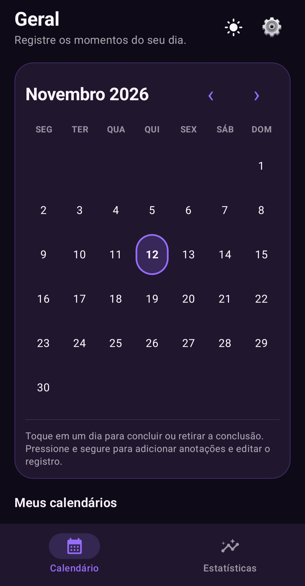
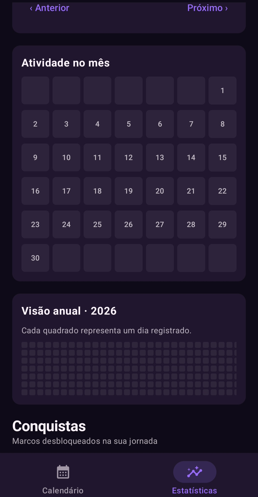
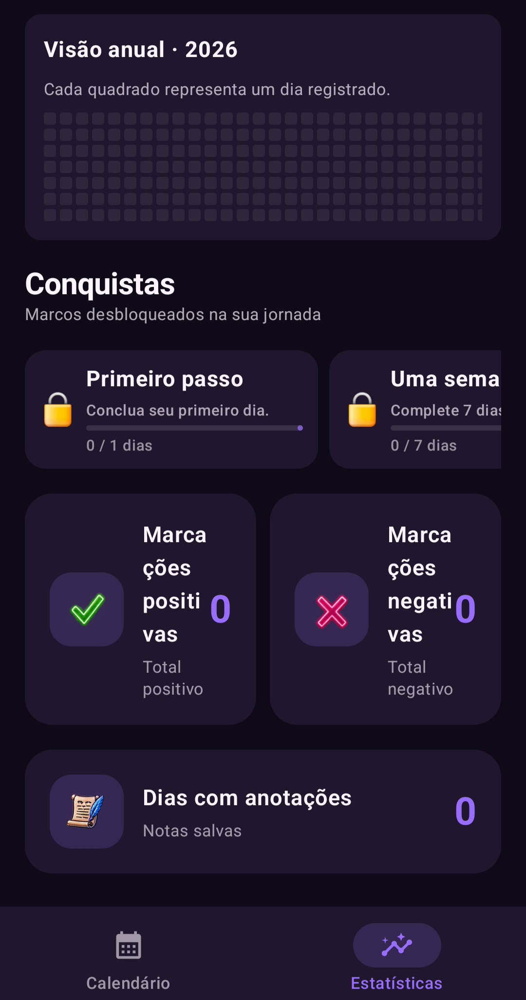
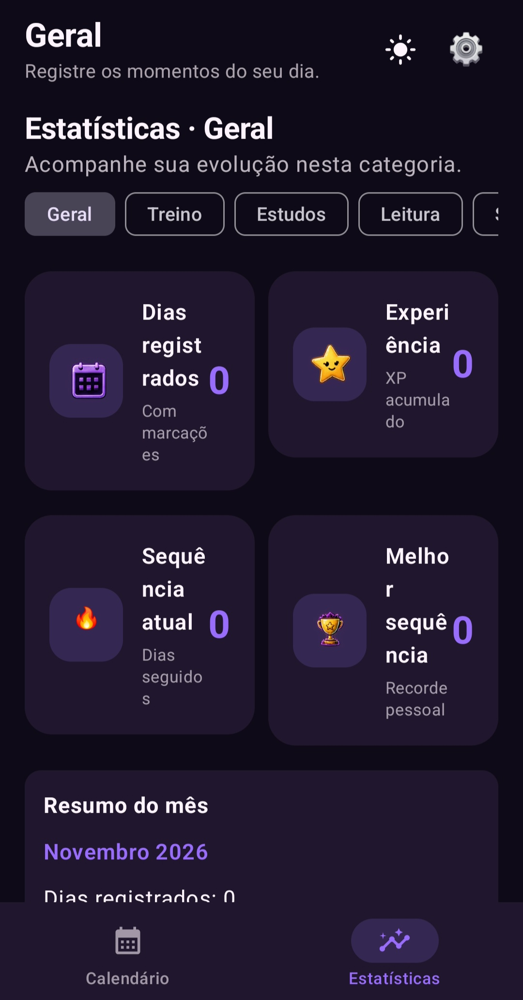
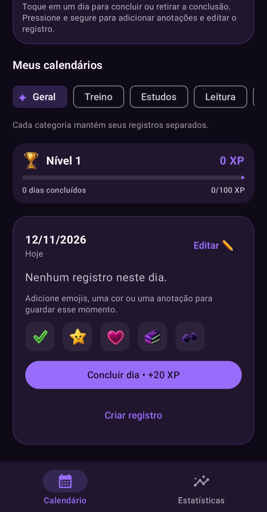

# Hábitos para Todos

### Transforme pequenas atitudes em grandes conquistas.

Um aplicativo Android de acompanhamento de hábitos que combina calendário, organização pessoal e elementos de gamificação inspirados em RPGs.

---

## 📦 Versão oficial — 2.0.0

A versão **2.0.0** está disponível! Esta versão reúne o calendário aprimorado, gamificação com XP e níveis, conquistas, temas visuais RPG e ícone personalizado.

**[Acessar a página da Release 2.0.0](https://github.com/NoNamekat/Habitos-para-Todos/releases/tag/v2.0.0)**

---

##  Sobre o projeto

O **Hábitos para Todos** nasceu com uma proposta simples: tornar o acompanhamento de hábitos mais visual, agradável e motivador. Em vez de apenas marcar tarefas como concluídas, o aplicativo transforma a consistência diária em uma experiência de evolução, com pontos de experiência, níveis e conquistas.

O projeto está em desenvolvimento e é construído de forma incremental, com testes em dispositivos Android.

## 🖼️ Prévia do aplicativo

Confira algumas telas reais do **Hábitos para Todos 2.0.0**:

<table>
  <tr>
    <td align="center">
       
      <strong>📅 Calendário</strong>
    </td>
    <td align="center">
       
      <strong>📊 Estatísticas</strong>
    </td>
    <td align="center">
       
      <strong>🏆 Evolução e conquistas</strong>
    </td>
  </tr>
  <tr>
    <td align="center">
       
      <strong>🎨 Temas RPG</strong>
    </td>
    <td align="center">
       
      <strong>✨ Personalização visual</strong>
    </td>
    <td></td>
  </tr>
</table>

##  Tecnologias

- **Kotlin**
- **Android**
- **Jetpack Compose**
- **Material 3**
- **SharedPreferences** para persistência local
- **Gradle**
- **GitHub Actions** para compilação automatizada do APK

##  Como compilar

### Requisitos

- JDK 17
- Android SDK
- Gradle compatível com a configuração do projeto

### Gerar o APK pelo GitHub Actions

1. Acesse a aba **Actions** do repositório.
2. Selecione o workflow de compilação Android.
3. Aguarde a execução terminar com sucesso.
4. Abra a execução concluída e baixe o artefato APK disponibilizado em **Artifacts**.

##  Estado do desenvolvimento

A versão **2.0.0** está publicada na página de Releases. O aplicativo continua em evolução, com novas funcionalidades, ajustes de interface e melhorias implementados e validados gradualmente.

##  Autor

Desenvolvido por **Abraão Jackson Aragão Rodrigues**.

---
